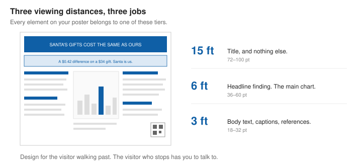
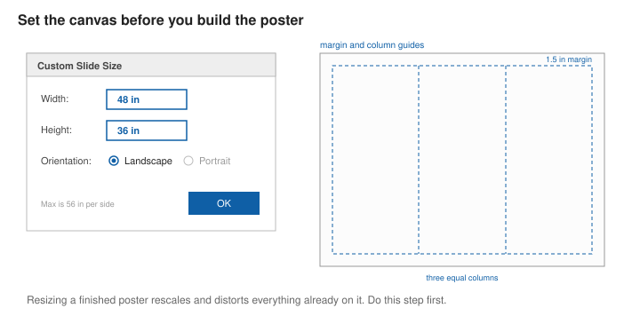
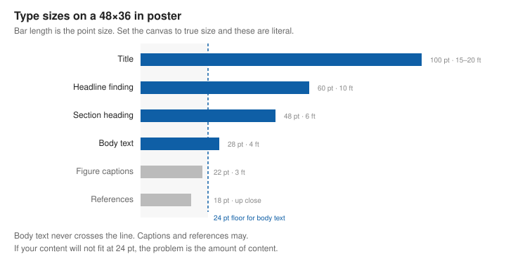

# Designing a Poster

A poster is conversation starter and memory aid. The goal is to quickly convey your main message to viewers, while having enough detail to support a deeper conversation.

That gives you two audiences: **Skimmers** need a title and findings, and **Stoppers** need you to point out details.

**Outcomes**:

- Adapt a written report into a poster
- Lay out a poster in columns with a clear reading order
- Choose type sizes that are legible at poster viewing distance
- Create a 48×36 inch poster file in PowerPoint
- Print using a 6-page version via Adobe & PDF

**Links**:

- [Garrett 2026 AAA presentation](GarrettAAA2026.pptx)
- [Sample Template](example-poster-48x36.pptx)

## How to create a good poster?

Start by creating text for a [paper](/pages/course_dv/dv46-report/index). At a minimum, you need a title/introduction, data, methods/results, and limitations. However, a poster will often break content into additional sections. For example, you should generally have a separate section for each chart or figure.

Once you have the content, start putting it into a chart format. Be sure to size the charts and figures appropriately for viewing at a distance.

### Poster Galleries

If you're having trouble figuring out how to design your poster, check out these sites.

- [WVU Libraries - Designing your poster](https://libguides.wvu.edu/c.php?g=903129&p=6500444)
- [F1000 Research Posters](https://f1000research.com/browse/posters?&selectedDomain=posters)
- [UMD Posters](https://our.umd.edu/poster-guide-design)
- [Yale Posters](https://guides.library.yale.edu/academic-poster-resources/basics)

## Process

Start by creating the poster in PowerPoint (or download my template):

1. **Design → Slide Size → Custom Slide Size**
2. Set **Width: 48 in**, **Height: 36 in**, orientation **Landscape**
3. Choose **Ensure Fit** if prompted
4. Delete every slide but one.

Other tips:

- **View → Guides** and **View → Gridlines**, so your columns line up.
- **Set a margin.** Nothing within 1.5 inches of any edge. 
- **Embed your fonts** File → Options → Save → *Embed fonts in the file*. A print shop may substitute something that shifts your layout.
- **Export to PDF for printing** not PPTX. Always open the PDF and look at it before sending.

### Writing

Target 300 to 500 words for the entire poster. Bullets beat paragraphs on a poster. Avoid paragraph longer than four lines.

Charts and images should occupy 40 to 60 percent of the poster area.

**Never go below 24 pt for body text.** If your content does not fit at 24 pt, you have too much content. At 48 inches wide, use **three or four columns**. Readers scan a poster the way they read a newspaper: down the first column, then down the next.

### Charts

**Rebuild the chart at poster scale.** A chart exported from Tableau at default settings carries 8–10 pt axis labels. Blown up to poster size those become blurry. Increase font sizes, line weights, and marker sizes inside Tableau or PowerBI *before* exporting.

**Export at print resolution.** Use PDF or SVG if your tool offers it, since those stay sharp at any size. If you must use PNG, export at 300 DPI at final print dimensions. A screenshot pasted into PowerPoint will look acceptable on your laptop and visibly pixelated on the wall.

A poster that uses a primarily visual argument style should have **three to six charts.** Posters that use a model (such as regression) can get away with fewer. However, you should still have at least 2, even for statistics-heavy concept.

### Printing

Posters are difficult to print, as they require a "plotter" - a special type of printer. I find the most success at Staples.

For our class, I recommend printing posters on six color sheets of standard letter-size paper and assembling them into one display. I still want you to submit a single PPTX file, but you can print on multiple sheets.

**Prepare your file**

1. Save your finished PowerPoint file. This is the file you will submit.
2. Export a PDF using PowerPoint’s **Save As** or **Export** command. Select PDF and standard or print-quality output.
3. Open the PDF and check for missing text, shifted objects, and blurry charts.
4. Open the PDF in the **Adobe Acrobat desktop application**. Use Acrobat’s print dialog rather than your web browser’s print dialog.

**Set up six-page printing**

1. Select **File → Print** and choose a color printer.
2. In **Page Setup** or the printer’s settings, select **Letter (8.5 × 11 inches)** and **Portrait** paper orientation. The poster itself remains landscape.
3. Under **Page Sizing & Handling**, select **Poster**.
4. Start with **Tile Scale: 45%** and **Overlap: 0.25 inches**. Enable **Cut marks** to help with trimming.
5. Inspect the preview. It should show **six sheets arranged in three columns
6. If the preview shows a different sheet count, adjust Tile Scale slightly until it shows six. Printer margins affect the result.
7. Select color, one copy, and single-sided printing. Turn off grayscale and double-sided printing.

Acrobat’s Poster option divides a PDF page into tiles. Its preview updates as you change the scale and overlap settings. Confirm the six-sheet layout before printing.

**Assemble your poster**

Lay out the six sheets in three columns and two rows. Trim the overlapping edges as needed, align the duplicated content, and tape the sheets together from the back. Assemble all 6 pages into a single poster before class.

I will provide tape in class to stick your poster on the whiteboard. However, you should have the poster already assembled into a single large poster. You will probably want to fold it for transport.

## References

Diagrams and sample template from Claude